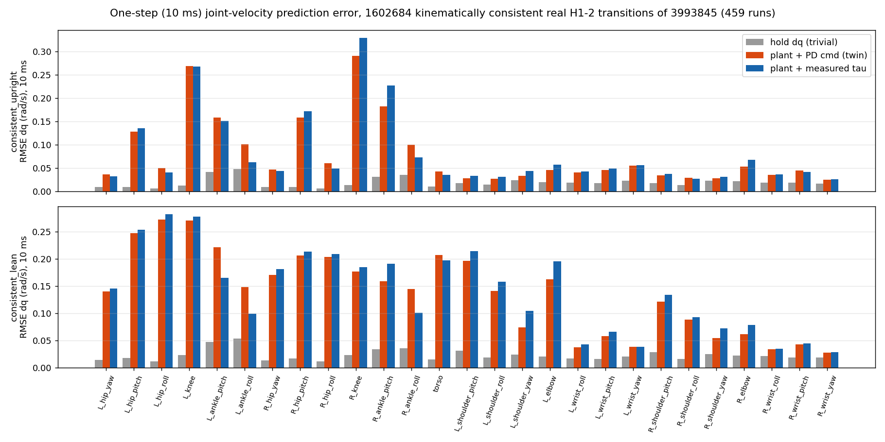
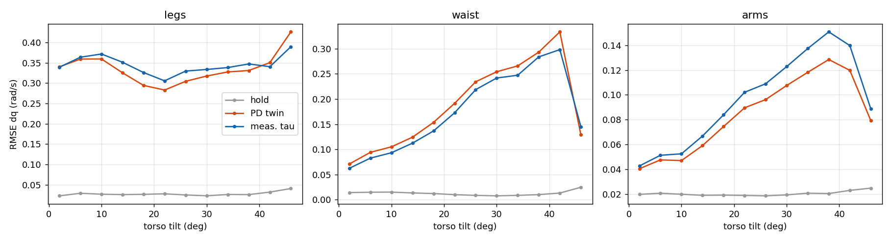
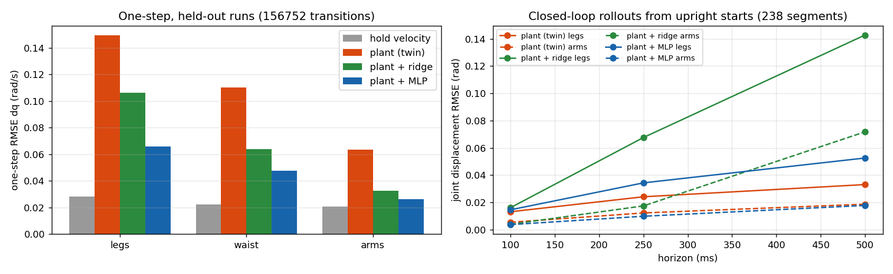

# Sim-to-real dynamics gap of the H1-2 planner plant, and a first learned residual

Date 2026-10-04, branch `mbrl`, workspace `mujoco_mpc/mujoco_mpc/mbrl/`. Offline only; nothing here touched
the live tree or the robot. Plan and sources: `RESEARCH_PLAN.md`.

## 1. Question

How far is the deployed planner plant (`Lean_H12_Magpie.xml`, the model iCEM imagines with) from the real
H1-2, measured on the robot's own recordings, and how much of that gap can a small learned residual close?

## 2. Data

493 real-robot recordings in `~/Desktop/h12/logs` (June to September 2026, every strategy family), 100 Hz,
6.1 M transitions with joint position, velocity, measured torque, the full PD command (target, kp, kd,
feed-forward), torso IMU and estimator base pose. Split by run: 80 / 10 / 10 train / val / test.

Filters. 4.0 M transitions have both feet loaded (knee or ankle torque above 5 Nm on each leg; the rest are
gantry-hung or limp-leg recordings). 1.6 M are "kinematically consistent": after the state reset below both
plant soles lie within 3 mm of the floor. All headline numbers use that subset; the rest is reported too.

## 3. Method

For every sample the plant is reset to the recorded state and stepped 10 ms (5 x 2 ms), then compared to the
recorded next sample. Two torque models: the PD command recomputed every substep (the twin as deployed) and
the measured torque held constant (rigid-body and contact model alone). The scale bar is the trivial
predictor "velocity stays the same".

The state reset is the part that took the night to get right, and each fix is a finding about the plant:

1. Pelvis orientation is the torso IMU quaternion composed back through the waist joint (the IMU site is on
   `torso_link`, not the pelvis).
2. The estimator height is not usable (one stand run had the feet 32 cm above the floor). Each foot is rotated
   flat onto the floor through its own ankle pitch and roll, then the pelvis height is bisected to the contact
   depth at which the vertical acceleration under the measured torques is zero. Contact normal force then
   matches the weight (687 N vs 674 N).
3. Base linear and angular velocity come from the stationary-feet constraint (least squares over both feet),
   not from the gyro and estimator, which conflict with the leg velocities and inject a reset impulse.
4. The table is moved away and the free object parked, since the real table height varied per run.
5. The planner-only keepaway spheres and the gripper and wrist collision shapes are made non-colliding: with
   the recorded arm poses they self-collide where the real hands do not. Arm error 1.52 -> 0.11 rad/s.

Scripts: `build_dataset.py`, `simgap.py`, `analyze_simgap.py`, `ablate_params.py`, `residual_fit.py`.

## 4. Results

### 4.1 One-step error of the plant (RMSE of the next joint velocity, rad/s, 10 ms)

| phase | group | hold velocity | plant + PD command (twin) | plant + measured torque | twin / hold |
|---|---|---|---|---|---|
| all | legs | 0.026 | 0.329 | 0.351 | 12.7 |
| all | waist | 0.013 | 0.193 | 0.192 | 14.6 |
| all | arms | 0.020 | 0.082 | 0.093 | 4.1 |
| upright | legs | 0.025 | 0.155 | 0.163 | 6.3 |
| upright | waist | 0.011 | 0.043 | 0.035 | 3.8 |
| upright | arms | 0.019 | 0.039 | 0.043 | 2.0 |
| lean | legs | 0.029 | 0.202 | 0.201 | 7.1 |
| lean | waist | 0.015 | 0.207 | 0.198 | 13.8 |
| lean | arms | 0.022 | 0.096 | 0.110 | 4.5 |




- Upright arms are the only place the twin is close to the trivial predictor (2x). Legs are 6 to 7x off,
  the waist 4x upright and 14x leaning. Error grows steeply with torso tilt for arms and waist.
- The PD-command and measured-torque columns agree within 10 %: the actuator model is not where the gap is.
  Reconstructed PD torque matches measured torque to 0.1 to 2 Nm RMSE per joint, with a +0.7 Nm bias on both
  ankle pitches.
- On the full loaded-feet set (not only consistent samples) the legs are 12.7x off: one foot floats.

### 4.2 Plant artifacts found on the way

| artifact | evidence | status |
|---|---|---|
| gripper / wrist collision shapes self-collide | arm one-step 1.52 -> 0.11 rad/s when non-colliding | disabled in this study; needs re-fit of the gripper geometry in the plant |
| right ankle pitch zero | best offsets per day: right +4, +4, +5, +8 deg; left +1, +1, +1, +2 (`out/ankle_offset_sweep.json`); per-sample flattening median right +3.8 deg, left -0.2 (upright +0.6) | matches the known 4 to 8 deg right-ankle zero error; the plant could carry a per-session calibration |
| left vs right sole height | with recorded q the plant soles differ by median 3.9 mm, p90 10.9 mm, p99 19 mm; up to 12 mm during leans, correlation -0.9 with knee asymmetry in two runs | a knee or hip zero / link-length error; a near-straight leg cannot close it through the knee (ill-conditioned), so it must be identified, not patched |
| joint damping, armature, friction loss | lowering any of them makes the error worse; damping 30 instead of 10 lowers it (legs 0.29 -> 0.20) | the real joints behave stiffer and more damped than the plant; a per-joint fit belongs in Stage 1b |

### 4.3 Learned residual (planner-known inputs only: q, dq, commanded torque, cmd - q, gains, gravity direction, pelvis rate)

Target: recorded next velocity minus the plant's prediction. Ridge regression and a 3 x 512 SiLU MLP,
trained on 1.25 M consistent transitions from the train runs, evaluated on the held-out test runs.

One-step RMSE on test runs (rad/s):

| model | legs | waist | arms | all |
|---|---|---|---|---|
| hold velocity | 0.028 | 0.022 | 0.021 | 0.024 |
| plant (twin) | 0.149 | 0.110 | 0.063 | 0.112 |
| plant + ridge | 0.106 | 0.064 | 0.033 | 0.076 |
| plant + MLP | 0.066 | 0.048 | 0.026 | 0.049 |

The MLP cuts the twin's one-step error 2.3x overall and brings the arms to within 1.25x of the trivial
predictor. The gain holds on every strategy family (3x on 10 of 12), and fails only on `stand6supp`, a June
supported-stand recording outside the training distribution.

Closed-loop rollouts on test runs (recorded PD commands replayed on the plant, residual applied as a velocity
correction after every 10 ms step, clipped at the 99.9th percentile of training targets; error = joint
displacement RMSE in rad; "diverged" = any joint error above 0.5 rad):

upright starts, 238 segments

| model | diverged | 100 ms legs | 100 ms arms | 250 ms legs | 250 ms arms | 500 ms legs | 500 ms arms |
|---|---|---|---|---|---|---|---|
| plant (twin) | 3 | 0.0131 | 0.0054 | 0.0241 | 0.0123 | 0.0331 | 0.0187 |
| plant + ridge | 5 | 0.0162 | 0.0040 | 0.0676 | 0.0174 | 0.1427 | 0.0717 |
| plant + MLP | 3 | 0.0146 | 0.0037 | 0.0343 | 0.0098 | 0.0525 | 0.0178 |

lean starts, 101 segments

| model | diverged | 100 ms legs | 100 ms arms | 250 ms legs | 250 ms arms | 500 ms legs | 500 ms arms |
|---|---|---|---|---|---|---|---|
| plant (twin) | 0 | 0.0166 | 0.0134 | 0.0406 | 0.0297 | 0.0632 | 0.0423 |
| plant + ridge | 23 | 0.0174 | 0.0064 | 0.0594 | 0.0265 | 0.1094 | 0.0608 |
| plant + MLP | 1 | 0.0191 | 0.0071 | 0.0534 | 0.0209 | 0.0790 | 0.0389 |



- Over 100 ms the MLP halves arm and waist error from upright starts. By 250 to 500 ms it compounds and is
  worse than the plain plant, and it never helps the legs. Ridge diverges in 28 of 339 segments.
- This is the expected failure of a one-step loss used in closed loop. It is the reason the next model is
  trained with a multi-step rollout loss, or injected as a generalized force rather than a velocity kick.

## 5. What this means for the MBRL thesis

The deployed planner imagines joint accelerations an order of magnitude off the robot's in the regimes that
matter (leaning, loaded legs), and most of the gap is geometry and calibration (gripper shapes, ankle zero,
leg kinematics), not actuator dynamics. A small residual learned from a few hours of logs recovers a 2.3x
one-step improvement with no hardware time, but one-step training does not survive a 0.5 s horizon, let alone
the planner's 1 s. Both halves of the thesis statement are therefore live: the model can be corrected from
data, and the correction has to be trained on the horizon it will be used at.

## 6. Next (in order)

1. Stage 1b: multi-step residual loss (unroll 25 to 50 plant steps with the residual in the loop, backprop
   through the residual only), and a residual-as-force variant.
2. Parametric identification with `mujoco.sysid` of: knee and ankle zero offsets per session, sole geometry,
   per-joint damping; then re-run `simgap.py` and see how much residual is left.
3. Re-fit the gripper collision shapes in the plant from the real hand geometry (planning needs them back).
4. Stage 2: residual inside `mjpc` rollouts; twin parity gate; then a real-robot A/B on strat 25.

## 7. Reproduce

```
cd ~/Desktop/h12/mujoco_mpc/mujoco_mpc/mbrl
.venv/bin/python build_dataset.py            # ~2 min, data/runs + manifest
MBRL_WORKERS=20 .venv/bin/python simgap.py   # ~20 min, data/simgap
.venv/bin/python analyze_simgap.py           # out/simgap_summary.json + figs
.venv/bin/python ablate_params.py            # out/ablate_params.json
.venv/bin/python residual_fit.py             # out/residual_summary.json, residual_mlp.pt
.venv/bin/python fig_residual.py
```

---

# Part 2 (same day): multi-step residual, identification, and the planner hook

## 8. The planner's step is part of the gap

MJPC rollouts take one 10 ms `implicitfast` step per planning step (`agent_timestep`), not five 2 ms substeps.
Re-running the one-step test with the planner's own step (4 runs, consistent samples):

| step | legs | waist | arms |
|---|---|---|---|
| 5 x 2 ms (Part 1 protocol) | 0.174 | 0.103 | 0.064 |
| 2 x 5 ms | 0.275 | 0.117 | 0.064 |
| 1 x 10 ms (planner) | 0.413 | 0.138 | 0.067 |

The planner's integration step alone more than doubles its leg error through contact. Arms are unaffected.
Everything below is therefore trained and evaluated at the planner's 1 x 10 ms step.

## 9. Two negative results worth keeping

- **Linearised multi-step training fails.** Finite-difference Jacobians of the 10 ms macro step along plant
  rollouts (`jacobians.py`, 4860 segments, 2.1 GB) have gains near 10^4 in the contact directions, and the
  25-step linear recursion diverges from the first iterate (`multistep_fit.py`). Linearising through stiff foot
  contact is not a usable training signal.
- **One-step error is a degenerate identification objective.** Nelder-Mead on damping/armature/torque scales
  against one-step velocity error converged to armature x2000: an immovable robot matches the trivial
  hold-velocity predictor. This also explains why "more damping looks better" in Part 1. Identification needs a
  horizon objective (section 11).

## 10. Residual trained on its own rollouts (Data-as-Demonstrator)

`rollout_engine.py` runs parallel nonlinear rollouts with a pluggable numpy residual; `dad_fit.py` iterates:
roll the plant plus current residual out on 3000 training segments, record the one-step target at every visited
state, aggregate, fine-tune. Validation = closed-loop displacement error on held-out segments (rad).

Post-step injection, 5 x 2 ms (Part 1 protocol), 221 consistent validation segments:

| model | 250 ms legs | 250 ms waist | 250 ms arms |
|---|---|---|---|
| plant | 0.0385 | 0.0564 | 0.0218 |
| one-step MLP (Part 1) | 0.0527 | 0.0467 | 0.0137 |
| DaD, 5 iterations | 0.0387 | 0.0152 | 0.0100 |

DaD removes the leg compounding (legs back to the plant's level) and halves arm error, waist 3.7x.

Pre-step injection at the planner's 1 x 10 ms step (what the planner hook can do), 352 validation segments, with
a per-group mask (`eval_masked.py`, `out/masked_dadpre10*.json`):

| configuration | 250 ms legs | 250 ms waist | 250 ms arms |
|---|---|---|---|
| plant | 0.0443 | 0.0552 | 0.0220 |
| 3x512 residual, all joints | 0.0478 | 0.0318 | 0.0153 |
| 3x512 residual, arms + waist only | 0.0417 | 0.0333 | 0.0155 |
| 2x64 residual, arms + waist only | 0.0417 | 0.0261 | 0.0133 |

A pre-step velocity kick on a planted foot is absorbed by the contact solver and hurts the legs, so the planner
configuration is arms + waist only. The 2x64 network is as good as the 3x512 one.

## 11. Parametric identification with a 250 ms rollout objective (`param_id2.py`)

Objective: plant-only 250 ms displacement error (legs + arms) on a fixed set of consistent training segments;
log-scale parameters bounded to [1/3, 3]; held-out test on 245 fixed segments.

| plant | 100 ms legs | 250 ms legs | 250 ms waist | 250 ms arms |
|---|---|---|---|---|
| nominal | 0.0181 | 0.0466 | 0.0367 | 0.0175 |
| fitted: damping x3.0 (both), leg armature x1.3, arm armature x0.33, torque x1.0 / x0.91 | 0.0106 | 0.0256 | 0.0275 | 0.0152 |

A 45 % cut in leg error from four scalars; damping sits at the upper bound, so the real joints are at least 3x
more damped than the plant's 10 Nm s/rad. Joint zero offsets on hip pitch and knee come out below 0.4 deg once
the feet are flattened, so the 12 mm sole gap of Part 1 is not a knee or hip zero error; sole geometry or link
lengths remain the candidates. These scales are a candidate planner XML change, to be gated on the twin.

## 12. Planner hook (Stage 2), built and smoke-tested

- `mjpc/tasks/humanoid_bench/lean/residual_mlp.{h,cc}`: binary weight loader, SiLU MLP forward, per-thread scratch,
  feature construction from planner quantities (q, dq, actuator force, ctrl - q, gains, gravity in the IMU frame,
  pelvis rate).
- `lean::ModifyRolloutState` applies the correction pre-step inside planner rollouts only (never on the real-robot
  path). Enabled by `H12_RESIDUAL_MLP=<file>` (from `export_mlp.py`), per-group scale `H12_RESIDUAL_SCALE=legs,waist,arms`
  with default `0,1,1`. Absent env = byte-identical behaviour.
- Own-sim smoke (`hook_smoke.py`, agent_server, strategy 25, 6 s): loads, plans, states finite, robot standing;
  trajectory differs 4 to 6 deg rms from the residual-free run.
- Cost: the 3x512 network made planning 4x slower (160 s vs 38 s wall); the 2x64 network costs ~5 % (41 s vs 39 s).
  `out/residual_dadpre10s.bin` is the deployable file.

## 13. Status and next

Done offline: measurement, residual, identification, planner integration, smoke test. Not done: twin bench with
the residual and with the fitted damping/armature (needs the robot NIC down, wire-check), then a real A/B on
strat 25 with the fixed-window protocol. Both are user-gated.

Reproduce Part 2:
```
MBRL_WORKERS=8 .venv/bin/python dad_fit.py                                    # study protocol, post-step
MBRL_H=64 MBRL_NL=2 MBRL_NSUB=1 MBRL_DT=0.01 MBRL_INJECT=pre MBRL_TAG=dadpre10s .venv/bin/python dad_fit.py
.venv/bin/python export_mlp.py dadpre10s; MBRL_H=64 MBRL_NL=2 .venv/bin/python eval_masked.py dadpre10s
.venv/bin/python param_id2.py
../../../h1_mujoco/.venv/bin/python hook_smoke.py ~/Desktop/h12/mujoco_mpc/monitor/proto out/residual_dadpre10s.bin 6
```
Every heavy job runs under `systemd-run --user --scope -p MemoryMax=12G -p MemorySwapMax=0`, one at a time.

## 14. Honest-twin A/B (robot off): residual OFF vs ON, slot 37 (strat 25 + 40 s stand sustain), B3, d37, `_real_ns`

Interleaved, 5 pairs, 180 s, proven honest protocol (rope 0.8, chunked payout, honest-gate release, no brace
assist), `mbrl/twin_ab.sh`, scored with `logs/twin_parity_0925/twin_score.py` (`logs/grid37_twin/d37/ab37_scores.csv`).
Note: plain strat 25 (slot 25) collapses during payout on this twin before any lean rung (base_r1 of the first,
aborted series), which is why slot 37 is the comparator.

| run | release s | pad load s | seat s | rung | done | fall s |
|---|---|---|---|---|---|---|
| base r1 | 42 | - | 0 | 3/9 | 0 | 68 |
| base r2 | 42 | - | 0 | 2/9 | 0 | 46 |
| base r3 | 42 | - | 0 | 2/9 | 0 | 45 |
| base r4 | 42 | 66 | 99 | 9/9 | 1 | - |
| base r5 | 42 | - | 0 | 3/9 | 0 | 64 |
| res r1 | never | - | 0 | 2/9 | 0 | stand collapse 57 s (squat, no fall) |
| res r2 | 78 | - | 0 | 2/9 | 0 | 101 |
| res r3 | never | - | 0 | 2/9 | 0 | stand collapse ~57 s |
| res r4 | 42 | 75 | 98 | 3/9 | 0 | 174 (seat twisted 100 deg yaw) |
| res r5 | 42 | - | 0 | 2/9 | 0 | 59 |

Baseline: 1 full pipeline, 4 pre-contact dive falls (today's twin is harsher than the 09-25 record of 0/4 dive
falls). Residual (arms + waist, 2x64, pre-step): 0 full pipelines, 2 of 5 runs sank into a squat while free-standing
before the honest gate ever released, a failure the baseline never shows; the one seat it reached was twisted.
Verdict: **the residual trained on recordings of the real robot does not transfer as a benefit to the twin's
planner, and the waist/arm pre-step corrections destabilise the planner's stand.** Two readings are possible and
the next two tests separate them: (a) the residual encodes real-robot-vs-plant differences that the twin plant does
not have (the twin IS a MuJoCo plant close to the planner's), so on the twin it is pure bias; (b) the pre-step
velocity kick itself perturbs the planner's stand. Test (a) needs the real robot. Test (b): own-sim 60 s with the
residual on/off, and an arms-only twin arm (`H12_RESIDUAL_SCALE=0,0,1`).

## 15. Own-sim 60 s, residual on vs off: the twin is the wrong oracle for a real-robot residual

`hook_smoke.py` for 60 s of own-sim (agent_server, strategy 25): residual OFF stands (pelvis z 0.996 at 60 s);
residual ON (arms + waist) falls (z 0.224), joint trajectories diverging 6 -> 29 deg rms. This is expected by
construction, not a bug: in own-sim and on the twin the ground truth IS a MuJoCo plant almost identical to the
planner's, so a residual that encodes real-robot-minus-plant differences is pure bias there, and a biased planner
imagination destabilises the stand. Consequences:
1. Sections 14 and 15 say nothing about whether the residual helps on the real robot; the offline evidence
   (section 10: arms/waist 250 ms error halved on held-out real recordings) is the only evidence about that.
2. The method (hook + DaD) can still be validated sim-to-sim: learn a residual from TWIN recordings against the
   planner plant (the twin differs by cone, noslip, PD-per-step, 5 ms step) and A/B it on the twin, where it is
   the correct correction. Today's A/B left 15 twin recordings (~45 min at 100 Hz) for exactly that.
3. A real-robot test of the real residual needs a safer staging than "on at scale 1": scale 0.25 -> 0.5 -> 1 with
   the fixed-window protocol, arms only first. User-gated.

Arms-only follow-up (`H12_RESIDUAL_SCALE=0,0,1`, 5 runs, same protocol): releases 42-45 s in 5/5 (no stand
collapse), 0 full pipelines, 4 falls, 1 brief pad load. The stand collapse of section 14 was the waist term; arms
only is neutral on the twin, as expected for a correction that is bias there.

## 16. Sim-to-sim: the same pipeline on the twin corpus (190 twin recordings, 3.1 M transitions, `data_twin/`, `out_twin/`)

Protocol validation. On the twin the foot-flattening corrections are 0.0 / 0.1 / 0.0 / 0.1 deg (L pitch, L roll,
R pitch, R roll) and the sole gap median is 1.1 mm (p90 5.0). On the real robot they were -0.2 / -0.8 / +3.8 / +1.0 deg
and 3.9 mm (p90 10.9). The reset protocol invents nothing on a clean plant, so the real robot's right-ankle zero
offset and leg kinematic mismatch are hardware facts.

Twin-plant vs planner-plant one-step (planner's 1 x 10 ms step; the twin steps 5 ms with PD per step, pyramidal
cone, noslip): consistent upright legs 2.4x hold, waist 4.1x, arms 5.1x; leaning 3.6x / 8.4x / 12.2x. The twin's
own joint-velocity signal is noisier than the real robot's (hold 0.095 rad/s on legs vs 0.026 real).

Twin-trained residual (DaD, 2x64, pre-step at 1 x 10 ms), 400 twin validation segments, 250 ms displacement RMSE:

| configuration | legs | waist | arms |
|---|---|---|---|
| plant | 0.0504 | 0.0446 | 0.0308 |
| twin residual, arms + waist | 0.0491 | 0.0261 | 0.0256 |
| twin residual, arms only | 0.0489 | 0.0550 | 0.0240 |

This residual is the correct correction for the twin by construction. Its twin A/B (section 17) is therefore the
test of the method: hook, injection point, DaD training, planner behaviour.

## 17. Sim-to-sim twin A/B: a correct residual still degrades the planner

Same protocol as section 14 (slot 37, B3, d37, `_real_ns`, 5 interleaved pairs, 180 s), residual = the twin-trained
2x64 net of section 16, arms + waist, pre-step (`logs/grid37_twin/d37/ab37_twinres_scores.csv`).

| arm | full pipeline | reached rung 9 | falls | longest seat |
|---|---|---|---|---|
| baseline | 1 / 5 | 3 / 5 | 3 | 115 s |
| twin residual, arms + waist | 0 / 5 | 0 / 5 (max rung 3) | 5 | 19 s |

The residual that is correct for the twin by construction, and that lowers the planner plant's 250 ms open-loop
error on twin data by 20-40 %, makes the closed-loop planner worse. Better short-horizon prediction on recorded
trajectories does not transfer to better planning. Two mechanisms, both testable offline:
1. Distribution shift under the planner: the residual was trained on recorded commands, but the sampling planner
   perturbs commands with its exploration noise inside every rollout; the correction is evaluated off its training
   distribution in exactly the rollouts that decide the plan. Fix: train DaD with planner-like command noise.
2. Exploitation: a pre-step velocity kick is motion the optimiser gets without torque; if the residual says "the
   waist drifts forward", the planner can lean on it. Fix: inject as a generalized force (through the inertia matrix
   and the contact solver) instead of a velocity kick, or evaluate the cost on the uncorrected step.
Next: (1) first, then (2) if needed; each is a twin DaD retrain (~5 min) plus a 35 min twin A/B.

## 18. Spotting check: residual trained on hands-off upright data only (`MBRL_MAX_TILT=12`)

The operator's hand (dive damping, catches) is an external force in neither the command nor the plant. Upright
phases (torso tilt < 12 deg) were hands-off. Same DaD recipe at the planner step, 2x64, pre-step; 250 ms
displacement RMSE (rad), held-out real segments:

| evaluated on | model | legs | waist | arms |
|---|---|---|---|---|
| upright only (282 seg) | plant | 0.0374 | 0.0057 | 0.0101 |
| upright only | all-data residual, arms+waist | 0.0372 | 0.0122 | 0.0075 |
| upright only | upright residual, all joints | 0.0336 | 0.0084 | 0.0070 |
| upright only | upright residual, arms only | 0.0369 | 0.0069 | 0.0070 |
| all (352 seg) | plant | 0.0443 | 0.0552 | 0.0220 |
| all | all-data residual, arms+waist | 0.0417 | 0.0261 | 0.0133 |
| all | upright residual, arms+waist | 0.0419 | 0.0243 | 0.0170 |

Findings: (1) upright, the plant's waist is already good and the all-data residual makes it worse: the waist
correction learned from lean phases is contaminated by spotting; (2) the upright-only residual is clean (arms -30 %,
legs -10 % upright, waist unchanged) and still cuts lean-phase waist/arm error, so part of the lean-phase gap is
real dynamics rather than the hand; (3) any residual meant for the robot should be trained hands-off (upright
subset or an external-wrench filter), and its waist term is the one to distrust. File: `out/residual_uprightpre10s.bin`.

## 19. Noise-robust twin residual (DaD with planner-like command noise, sigma 0.08 rad)

Same twin A/B (`ab37_twinnoise_scores.csv`). Residual-on: pad loaded 5/5 (61-67 s), one 63 s seat, max rung 3, 5 falls
(67-143 s). Baseline this round: pad loaded 2/5, reached rung 9 once (28 s seat), 5 falls (53-114 s). Neither arm
completed. Training with planner-like noise removed the clear harm of section 17 but produced no measurable gain.

Bench variance. Pooled baselines of the three rounds (15 runs, same protocol): 2 full pipelines, 7 reached rung 9,
12 falls; per round 1/3/1 reached-rung-9 and 1/1/0 pipelines. Five-pair fall counts cannot resolve anything short
of a large effect. The sensitive metric for a dynamics residual is the planner's own imagination error in closed
loop: the trajectory it planned vs what the twin then did over the next 0.25-1 s (iCEM rollout dump). That is the
next measurement, before any further residual variants.
